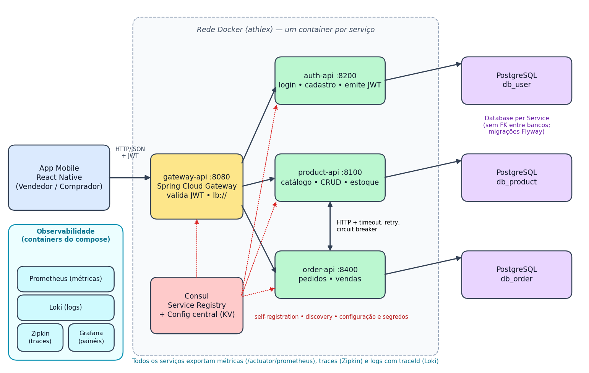

# Athlex — Arquitetura, padrões e testes (G2)



## 1. Módulos do repositório
Dois repositórios: **athlex-mobile** (este) e **athlex-backend**.
```
athlex-mobile/   App React Native (Expo)
athlex-backend/  Microservices Java (Spring Boot 4 / Spring Cloud)
│   ├── gateway-api   ponto único de entrada, valida JWT, roteia via Consul (lb://)
│   ├── auth-api      cadastro (perfil comprador/vendedor), login, emissão do JWT
│   ├── product-api   catálogo, CRUD do vendedor, estoque
│   └── order-api     pedidos, histórico de compras e de vendas
└── docs/      este documento
```
Cada módulo tem responsabilidade única e comunica-se por contrato HTTP/JSON (gateway) ou descoberta de serviços (Consul).

## 2. Arquitetura do app (camadas)
```
Presentation  screens/ components/ navigation/     UI e navegação por perfil
Application   context/ (Auth, Cart)                estado e casos de uso da sessão
Domain        domain/ (validators, pricing, masks, permissions)   regras puras, sem React
Data          services/ (ApiClient → HttpApi | MockApi)          acesso a dados
```
Regra de dependência: camadas superiores dependem das inferiores, **nunca o contrário**; `domain/` não importa React nem rede.

## 3. Arquitetura do backend (por microservice)
`controllers` (HTTP/DTO) → `services` (regras e autorização) → `repositories` (JPA) → `entities`.
Autenticação centralizada no gateway (JWT stateless); autorização nos serviços (`AuthorizationService`).

## 4. Boas práticas e padrões aplicados
| Conceito | Onde | Por quê |
|---|---|---|
| **Dependency Inversion / Adapter** | `services/apiClient.js` (contrato JSDoc) + `httpApi.js`/`mockApi.js` | telas dependem de contrato, não de rede |
| **Composition Root / Factory** | `services/api.js` | único ponto que escolhe a implementação |
| **Provider / Observer** | `AuthContext`, `CartContext` | estado compartilhado sem prop drilling |
| **Single Responsibility** | `domain/validators`, `pricing`, `permissions`; `PricingCalculator` (Java) | regra isolada e testável |
| **Guarda de acesso (Guard)** | `RequireSeller`, `AuthFilter` | restrição de perfil na UI **e** no servidor |
| **Layered Architecture** | app e backend | separação de preocupações |
| **DTO** | `Dtos.java` (records) | contrato da API desacoplado das entidades |
| **Fail fast / validação** | `ProductService.apply`, `validators` | 400 com mensagem clara |
| **Compensação (Saga simplificada)** | `OrderService.create` | se a baixa de estoque falha no meio, devolve o já reservado |
| **Princípio do menor privilégio** | `/internal/**` sem rota no gateway | endpoints service-to-service não ficam públicos |
| **Fonte única da verdade** | `theme.js`, `PRECO_*` | evita divergência de valores |
| **DRY** | `ui.jsx`, `NeedLogin`, `Stepper` | componentes reutilizados |

## 5. Segurança e perfis
JWT (claims `id`, `type`, `email`) emitido pelo auth-api e validado no gateway. `type`: 0 admin, 1 comprador, 2 vendedor.
Comprador tentando manutenção de produto → **403** (backend) e tela "Acesso restrito" (app). Vendedor só altera/exclui **os próprios** produtos. O filtro do gateway descarta `X-User-*` forjados.

## 6. Estratégia de testes
| Camada | Ferramenta | O que cobre | Qtde |
|---|---|---|---|
| App — domínio | Jest | validadores, máscaras, preço, permissões | 12 |
| App — dados (MockApi) | Jest | login/cadastro, 403 comprador, dono do produto, baixa de estoque, vendas, 401 | 9 |
| Gateway | JUnit | 401 sem/ com token inválido ou expirado, anti-spoofing de cabeçalhos | 4 |
| auth-api | JUnit + Mockito | perfil no cadastro, hash de senha, 409, 401, JWT | 9 |
| product-api | JUnit + Mockito | autorização (comprador/dono/admin), validações, estoque 409 | 16 |
| order-api | JUnit | regra de preço, autorização de vendas/pedidos | 9 |

Pirâmide: base de testes unitários rápidos nas regras puras (sem banco/rede); `MockApi` permite testar fluxos do app sem backend.
Integração: `backend/infra/roteiro_api.py` (29 verificações via gateway, com Consul + PostgreSQL reais) e `mobile/__integration__` (8 testes do cliente HTTP do app contra o backend real). Foram executados e passaram; nesse processo foram encontrados e corrigidos 2 defeitos que os testes unitários não pegavam (busca com parâmetro nulo no PostgreSQL e conflito da porta 8300 com o Consul).
Não coberto (limitação): testes automatizados de UI (E2E de telas).

## 7. Decisões e limitações
- App em **JavaScript** (conforme o enunciado); os contratos (`ApiClient`, modelos de domínio) são documentados com **JSDoc** em `src/services/apiClient.js` e `src/types.js`.
- Imagens como data URI base64 no banco (simples; em produção usar storage de objetos).
- Schema versionado com **Flyway**; segredos (senha do banco, chave JWT, senha do admin) apenas no Consul KV, gravados a partir do `.env` não versionado.
- Estoque: baixa atômica no banco (`UPDATE ... WHERE stock >= :qty`); fluxo de pagamento é simulado.

## 8. Infraestrutura e requisitos não funcionais (backend)
| Tema | Decisão | Onde |
|---|---|---|
| Isolamento de dados | Database per Service: 3 bancos/volumes, sem FK entre eles (referências por id) | `docker-compose.yml`, `db/migration` |
| Evolução do schema | Flyway `V1__*.sql` idempotente; Hibernate só valida | cada `src/main/resources/db/migration` |
| Configuração | Consul KV `config/<serviço>/...`; propriedades locais só com o endereço do Consul | `infra/consul_kv.sh`, `application.properties` |
| Segredos | `.env` (fora do Git) → Consul KV; sem valor padrão no código; falha rápida se ausentes | `.env.example` |
| Resiliência | timeout + retry (GET) + circuit breaker (Resilience4j) + compensação de estoque; falha → 503 sem detalhes internos | `ProductClient`, `ResilienceConfig` |
| Observabilidade | Prometheus + Grafana (métricas), Zipkin (traces), Loki (logs) com `traceId` | `infra/`, `logback-spring.xml` |
| Entrega | Dockerfile multi-stage (usuário não-root) por serviço; compose com healthchecks e ordem de subida | `*/Dockerfile`, `docker-compose.yml` |

Rastreabilidade: o `traceId` aparece no log de cada serviço (`[serviço,traceId,spanId]`) e liga o log ao trace no Zipkin (`gateway-api → order-api → product-api`).

Exceções documentadas: Consul em modo dev (KV em memória, regravado a cada `up`); serviços internos publicados no compose apenas pelo gateway; consistência de estoque por compensação (sem Saga/mensageria, fora do escopo).
